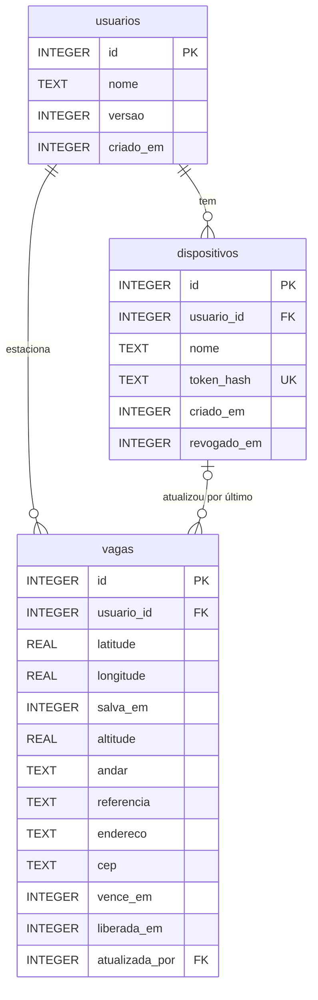

# Banco de dados

O projeto tem dois bancos SQLite: um **no aparelho** (`expo-sqlite`, criptografado com SQLCipher) e um **no servidor** (`node:sqlite`). O banco do aparelho funciona sozinho. O do servidor só é usado quando a sincronização está ligada.

## Servidor

### `usuarios`

Uma pessoa (ou família) que compartilha a mesma vaga entre aparelhos.

| Coluna | Tipo | Regras | Descrição |
|---|---|---|---|
| `id` | INTEGER | PK | Identificador |
| `nome` | TEXT | 1 a 60 caracteres | Nome exibido |
| `versao` | INTEGER | `>= 0`, padrão 0 | Contador de mudanças da vaga, usado no controle de concorrência (`If-Match`) |
| `criado_em` | INTEGER | obrigatório | Data em ms (Unix) |

### `dispositivos`

Cada aparelho autorizado a ler e alterar a vaga do usuário.

| Coluna | Tipo | Regras | Descrição |
|---|---|---|---|
| `id` | INTEGER | PK | Identificador |
| `usuario_id` | INTEGER | FK → `usuarios.id`, `ON DELETE CASCADE` | Dono do aparelho |
| `nome` | TEXT | 1 a 60 caracteres | Ex.: "Celular da Ana" |
| `token_hash` | TEXT | único, 64 caracteres | SHA-256 do token. O token em si nunca é salvo |
| `criado_em` | INTEGER | obrigatório | Data em ms |
| `revogado_em` | INTEGER | opcional | Preenchido para bloquear o aparelho |

### `vagas`

Histórico de vagas. Cada usuário tem no máximo **uma vaga ativa** (`liberada_em IS NULL`), garantido pelo índice único parcial `vagas_uma_ativa_por_usuario`.

| Coluna | Tipo | Regras | Descrição |
|---|---|---|---|
| `id` | INTEGER | PK | Identificador |
| `usuario_id` | INTEGER | FK → `usuarios.id`, `ON DELETE CASCADE` | Dono da vaga |
| `latitude` | REAL | entre -90 e 90 | Posição do carro |
| `longitude` | REAL | entre -180 e 180 | Posição do carro |
| `salva_em` | INTEGER | obrigatório | Quando a vaga foi salva (ms) |
| `altitude` | REAL | opcional | Altitude estimada pelo barômetro (m) |
| `andar` | TEXT | até 20 caracteres | Preenchido à mão, ex.: "G2" |
| `referencia` | TEXT | até 120 caracteres | Ex.: "Pilar B14" |
| `endereco` | TEXT | até 160 caracteres | Ex.: "Praça da Sé, 100 - Sé, São Paulo/SP" |
| `cep` | TEXT | vazio ou exatamente 8 dígitos | CEP do local, sem traço |
| `vence_em` | INTEGER | maior que `salva_em` | Fim do parquímetro (ms) |
| `liberada_em` | INTEGER | opcional | Quando a vaga foi liberada. Nulo significa vaga ativa |
| `atualizada_por` | INTEGER | FK → `dispositivos.id`, `ON DELETE SET NULL` | Último aparelho que alterou |

### Relacionamentos

- **usuarios 1 : N dispositivos.** Um usuário conecta vários aparelhos. Apagar o usuário apaga os aparelhos.
- **usuarios 1 : N vagas.** Guarda o histórico, mas só uma vaga fica ativa por vez.
- **dispositivos 1 : N vagas** (opcional). Indica quem fez a última alteração. Se o aparelho for apagado, o campo vira nulo e a vaga continua.

### Garantias de integridade

- `PRAGMA foreign_keys = ON` faz o SQLite respeitar as chaves estrangeiras.
- Os `CHECK` do esquema repetem as regras da validação da API. Mesmo um bug no código não grava dado fora da regra.
- Toda alteração roda numa transação `BEGIN IMMEDIATE`, que confere a versão e grava junto. Se duas alterações chegam ao mesmo tempo, uma recebe `409 Conflict`.
- O modo WAL permite ler (inclusive pelo SSE) enquanto se escreve.

## Migrações

Os dois bancos guardam a versão do esquema em `PRAGMA user_version` e mantêm a lista de migrações em ordem (`MIGRATIONS` em `server/db.ts` e `src/lib/db.ts`). Ao abrir, aplicam numa transação só as que faltam. Assim, um banco antigo ganha as colunas novas sem perder dados.

| Versão | Mudança |
|---|---|
| 1 | Tabelas iniciais |
| 2 | Colunas de endereço e CEP (`endereco`/`cep` no servidor, `address`/`cep` no aparelho) |

## Aparelho

Uma única tabela, `vaga`, com uma única linha (`id = 1`). Ela é o estado atual do aparelho e a fila de sincronização ao mesmo tempo.

| Coluna | Tipo | Regras | Descrição |
|---|---|---|---|
| `id` | INTEGER | PK, sempre 1 | Linha única |
| `latitude`, `longitude`, `savedAt` | REAL / INTEGER | todos nulos ou todos preenchidos | Nulos significa nenhuma vaga salva |
| `altitude` | REAL | opcional | Altitude pelo barômetro |
| `floor` | TEXT | até 20 caracteres | Andar |
| `note` | TEXT | até 120 caracteres | Descrição opcional (ex.: vaga, ponto de referência) |
| `address` | TEXT | até 160 caracteres | Endereço em uma linha |
| `cep` | TEXT | vazio ou exatamente 8 dígitos | CEP sem traço |
| `expiresAt` | INTEGER | maior que `savedAt` | Fim do parquímetro |
| `notificationId` | TEXT | opcional | Id do aviso agendado **neste** aparelho. Não é sincronizado |
| `version` | INTEGER | `>= 0` | Última versão do servidor conhecida |
| `dirty` | INTEGER | 0 ou 1 | 1 significa que há mudança local ainda não enviada (ex.: feita offline) |

O arquivo é criptografado com **SQLCipher**. A chave tem 256 bits, é gerada no primeiro uso e fica no Android Keystore / iOS Keychain (`expo-secure-store`).
