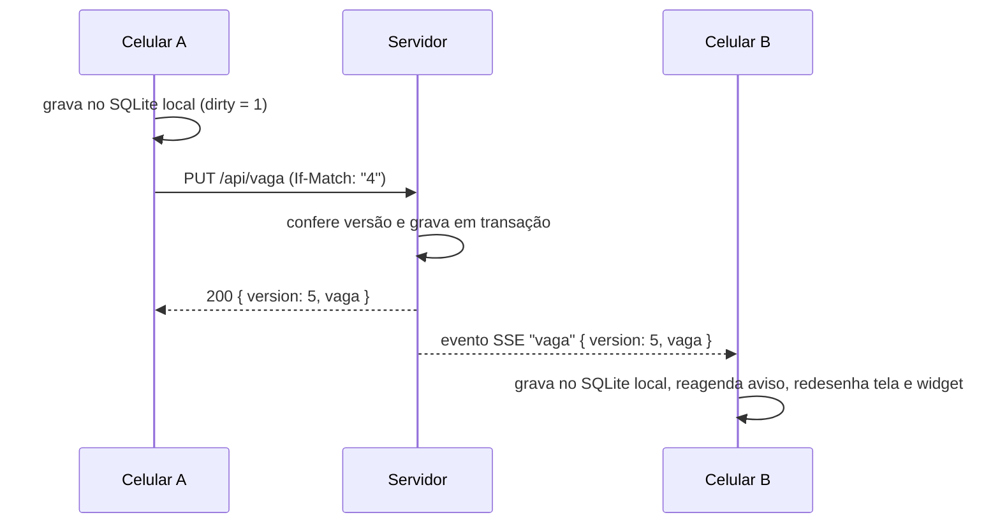

# Funcionalidades

Como cada conceito pedido no projeto aparece no app.

## Localização e mapas

- Na primeira abertura, a tela de **permissões** explica para que servem a localização e os avisos antes do pedido do sistema. Sem permissão, o app continua funcionando pelo mapa e pelo CEP.
- **Adicionar vaga** abre o formulário (`/vaga`) com três jeitos de marcar o local: **Onde estou** (GPS com a maior precisão, `expo-location`), **No mapa** (seletor em tela cheia com o pino fixo no centro) e **Pelo CEP**. Uma prévia do mapa mostra sempre o ponto escolhido. Também tem rua, número, andar, descrição opcional e tempo do parquímetro. Detalhes em [telas.md](telas.md).
- A **home** mostra a vaga numa prévia do mapa que não arrasta. Tocar nela abre o mapa em tela cheia (`/mapa`).
- O **CEP** é consultado no ViaCEP. A conversão entre endereço e coordenada usa o Nominatim (OpenStreetMap), respeitando o limite de 1 consulta por segundo e identificando o app no cabeçalho `User-Agent` (`src/lib/address.ts`). As respostas desses serviços são validadas antes de entrar no formulário.
- O mapa (MapLibre, com mapas gratuitos do OpenFreeMap/OpenStreetMap) mostra você e o carro, desenhado como símbolo nativo com o pino da logo (`src/components/car-layer.tsx`).
- **Traçar rota a pé** pede o caminho a um servidor OSRM com perfil a pé (`src/lib/route.ts`). A resposta é validada (`parseRoute`) e a linha vai da sua posição até o carro. A câmera enquadra a rota inteira acima do cartão. Sem internet ou sem rota, aparece uma linha reta tracejada, avisando que é só a direção.
- A distância é calculada no aparelho pela fórmula de Haversine (`src/lib/geo.ts`).

## Notificações

- Ao escolher **30 min**, **1 h** ou **2 h**, o app agenda uma notificação local para **10 minutos antes** do vencimento (`src/lib/notifications.ts`).
- Mudar o tempo ou liberar a vaga cancela o aviso anterior.
- Se o tempo muda em outro aparelho, o aviso também é reagendado neste aparelho, pela sincronização.

## Widget

- Widget Android (`react-native-android-widget`) com a distância, o tempo restante, o horário de vencimento, o andar e a descrição. Tocar nele abre o app.
- A home tem o cartão **Widget na tela inicial**, com uma prévia do widget com os dados atuais (`src/components/widget-card.tsx`). O botão **Adicionar à tela inicial** abre o pedido nativo do Android (`requestPinWidget`). Se o launcher não aceitar esse pedido, o app explica o caminho manual: segurar o dedo na tela inicial, tocar em **Widgets** e arrastar o **Onde Estacionei?**. O cartão some quando o widget já está na tela.
- O app redesenha o widget sempre que a vaga muda. O Android também atualiza o widget a cada 30 minutos.
- O widget só existe no APK instalado (build nativo). Ele não aparece no Expo Go nem no iOS.
- O arquivo do widget começa com `'use no memo'`: sem isso, o React Compiler transforma o componente e a biblioteca recusa desenhar o widget.

## Sensores

- O barômetro (`expo-sensors`, hook `src/hooks/use-pressure.ts`) lê a pressão do ar. Ao salvar a vaga, o app guarda a altitude estimada. No formulário, isso só acontece se o pino estiver a até 50 m de você.
- Na volta, compara com a altitude atual e mostra, por exemplo, "2 andares acima de você" (3 m por andar).
- Os campos **Andar** e **Descrição** do formulário servem como complemento manual.

## Persistência (SQLite)

- A vaga fica no SQLite do aparelho (`expo-sqlite`), criptografado com SQLCipher. Ela continua salva com o app fechado ou sem internet.
- Detalhes em [banco-de-dados.md](banco-de-dados.md).

## Tempo real (SSE)

- Opcional. Com um servidor configurado, os aparelhos do mesmo usuário compartilham a vaga. Por exemplo: você estaciona e o celular de quem está com você já mostra o carro, o tempo e o aviso.
- O app abre um fluxo **Server-Sent Events** (`GET /api/eventos`, via `react-native-sse`). Cada mudança chega na hora e a tela é redesenhada.
- Ao conectar ou reconectar, o servidor manda o estado atual. Assim, o que mudou offline é sincronizado na hora (`src/lib/reconcile.ts`).
- Detalhes da API em [api.md](api.md).

## Fluxo de uma alteração

Se A estiver offline, a mudança fica com `dirty = 1` e é enviada quando o SSE reconectar. Se B tiver mudado antes, o servidor responde `409`, o servidor vence e A copia o estado dele.
