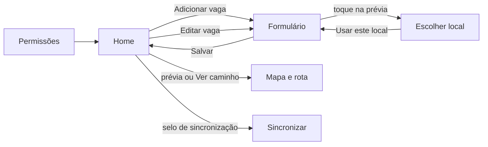
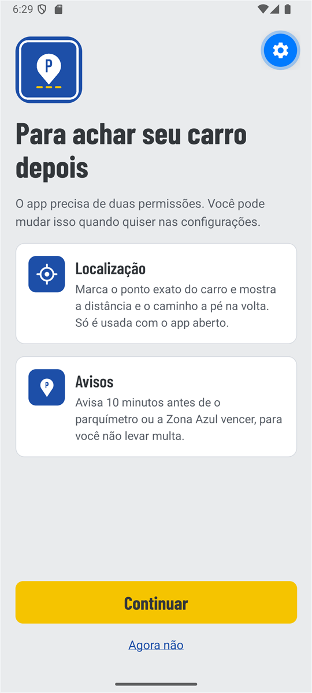
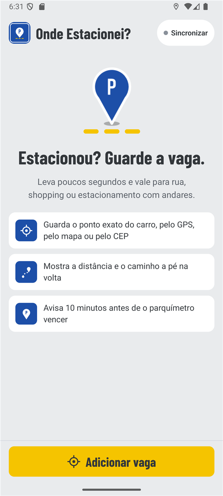
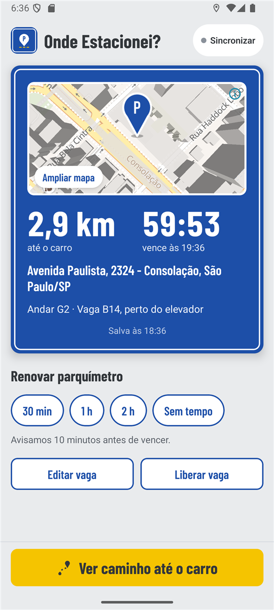
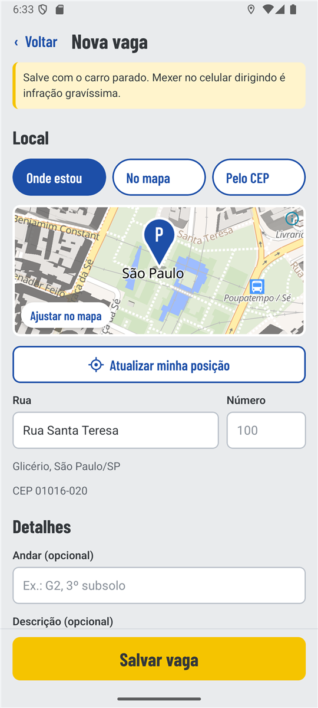
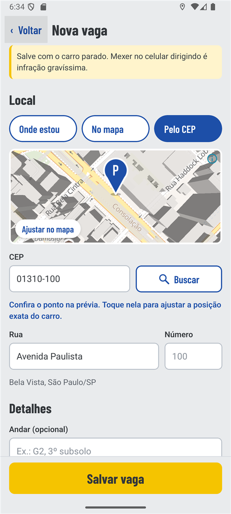
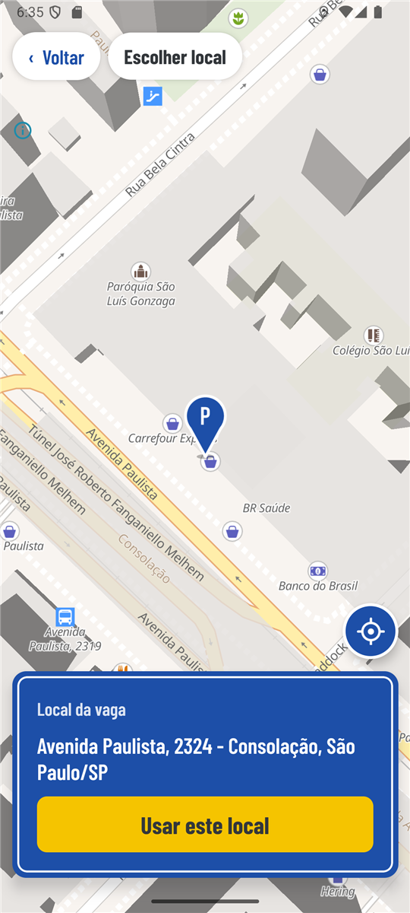
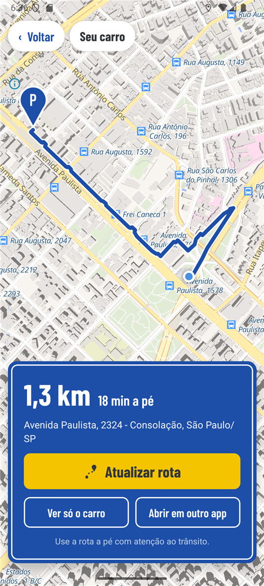
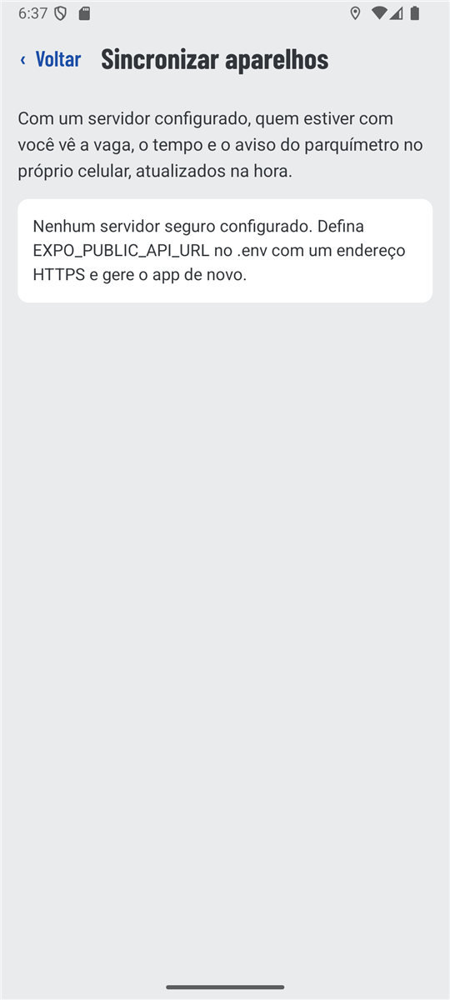

# Telas

O app usa **Expo Router**: cada arquivo em `src/app/` é uma tela. Os prints abaixo foram tirados no emulador Android (API 35).

| Rota | Arquivo | Para quê |
|---|---|---|
| `/permissoes` | `src/app/permissoes.tsx` | Explica e pede localização e avisos na primeira abertura |
| `/` | `src/app/index.tsx` | Home: convite para adicionar a vaga, ou resumo da vaga salva |
| `/vaga` | `src/app/vaga.tsx` | Formulário para adicionar ou editar a vaga |
| `/escolher-local` | `src/app/escolher-local.tsx` | Seletor do local em tela cheia (pino fixo no centro) |
| `/mapa` | `src/app/mapa.tsx` | Mapa em tela cheia com o carro e a rota a pé |
| `/sincronizar` | `src/app/sincronizar.tsx` | Conectar o aparelho ao servidor de sincronização |

## Permissões (`/permissoes`)

Aparece só enquanto o Android ainda não perguntou sobre a localização. Antes do pedido do sistema, explica para que serve cada permissão. **Continuar** pede localização e depois avisos. **Agora não** segue para a home sem pedir nada, e o app continua útil: a vaga pode ser salva pelo CEP ou pelo mapa.

## Home (`/`)

| Sem vaga | Com vaga |
|---|---|
|  |  |

- **Sem vaga:** o pino da logo pousado na faixa amarela, o convite "Estacionou? Guarde a vaga." e três benefícios. **Adicionar vaga** fica fixo embaixo.
- **Com vaga:** a placa azul mostra a **prévia do mapa** (toque para **ampliar**), a distância, o tempo do parquímetro (com o horário de vencimento), a diferença de andares pelo barômetro, o endereço, o andar e a descrição. Abaixo ficam a renovação rápida do parquímetro, **Editar vaga** e **Liberar vaga**. **Ver caminho até o carro** fica fixo embaixo.
- **Selo de sincronização** (canto superior): mostra o estado da conexão e abre **Sincronizar**.
- **Localização negada:** um aviso explica o que deixa de funcionar e leva às configurações.

## Adicionar ou editar vaga (`/vaga`)

| Onde estou | Pelo CEP |
|---|---|
|  |  |

Três seções:

1. **Local.** Escolha entre **Onde estou** (GPS), **No mapa** e **Pelo CEP**. Em todos os modos a **prévia do mapa** mostra o ponto escolhido, e tocar nela abre o seletor em tela cheia para ajustar. O GPS e o mapa preenchem rua, número, bairro, cidade e CEP sozinhos. O CEP é consultado no ViaCEP e o ponto é encontrado no mapa. Rua e número continuam editáveis.
2. **Detalhes.** **Andar** e **Descrição** são opcionais. A descrição mostra um contador (máximo de 120 caracteres).
3. **Parquímetro ou Zona Azul.** **Sem tempo**, 30 min, 1 h ou 2 h. Ao editar, aparece também **Manter (até HH:MM)**.

**Salvar vaga** fica fixo embaixo, sobe junto com o teclado e só libera depois que há um local. No topo, um aviso lembra de salvar com o carro parado.

| Situação | Mensagem |
|---|---|
| CEP com menos de 8 números | "Digite os 8 números do CEP." |
| CEP inexistente | "CEP não encontrado. Confira os números ou escolha no mapa." |
| CEP encontrado | "Confira o ponto na prévia. Toque nela para ajustar a posição exata do carro." |
| Endereço sem ponto no mapa | "Achamos o endereço, mas não o ponto. Toque na prévia para marcar no mapa." |
| GPS sem resposta | "O GPS não respondeu. Vá para um local aberto ou escolha no mapa." |
| Localização desligada | "A localização está desligada. Use o mapa ou o CEP." |
| Texto inválido ao salvar | "Confira os dados", dizendo qual campo |

## Escolher local (`/escolher-local`)

O pino da logo fica fixo no centro. A pessoa arrasta o mapa (ou toca num ponto) até o pino ficar sobre o carro. Quando o mapa para, o endereço do ponto aparece no cartão, com espera de 0,6 s para não consultar a cada ajuste. O botão redondo leva à posição atual. **Usar este local** devolve o ponto e o endereço ao formulário.

## Mapa e rota (`/mapa`)

- O carro aparece com o pino da logo, como símbolo nativo do mapa. A sua posição é o ponto azul do sistema.
- **Traçar rota a pé** calcula o caminho pelo OSRM e **enquadra a rota inteira acima do cartão**, cuja altura é medida na tela. A linha é azul com contorno branco e vai da sua posição até o carro.
- Sem rota pelas ruas (sem internet ou sem caminho), aparece uma **linha tracejada** em linha reta, com um aviso de que ela só mostra a direção.
- **Ver só o carro** e **Ver a rota** alternam o enquadramento. **Abrir em outro app** abre a vaga no app de mapas do celular.
- Aberta pelo botão **Ver caminho até o carro**, a rota é traçada assim que o GPS responde.

## Sincronizar (`/sincronizar`)

| Estado | O que aparece |
|---|---|
| Sem `EXPO_PUBLIC_API_URL` seguro no `.env` | Explica como configurar. A vaga fica só neste aparelho |
| Desconectado ou token recusado | Campo **Token do aparelho** (oculto) e **Conectar** |
| Conectando, online ou offline | Estado da conexão e **Desconectar este aparelho** |

## Widget da tela inicial (Android)

Arquivo `src/widget/parking-widget.tsx`. Mostra a distância até o carro, os minutos restantes, o horário de vencimento, o andar e a descrição. Tocar abre o app.

Na home, o cartão **Widget na tela inicial** (`src/components/widget-card.tsx`) mostra uma prévia com os dados atuais e o botão **Adicionar à tela inicial**, que abre a confirmação do Android. O cartão some depois que o widget é adicionado.

## Uso seguro e posicionamento na tela

| Norma ou diretriz | Como o app atende |
|---|---|
| **Código de Trânsito Brasileiro, art. 252, VI**: dirigir manuseando o celular é infração gravíssima | O formulário avisa para salvar com o carro parado, e o mapa lembra de usar a rota com atenção ao trânsito |
| **Permissão com contexto** (diretrizes do Android) | O app explica cada permissão antes do pedido do sistema, pede só "durante o uso" e funciona sem ela |
| **Zona do polegar** (uso com uma mão) | A ação principal de cada tela (**Adicionar vaga**, **Salvar vaga**, **Ver caminho**, **Usar este local**) fica fixa embaixo |
| **Alvos de toque**: Material Design (48 dp) e Apple HIG (44 pt) | Botões, pílulas, links, campos e o botão Voltar têm pelo menos 48 dp |
| **Áreas seguras** (barra de status, recorte da câmera, barra de navegação) | `react-native-safe-area-context` afasta cabeçalhos, créditos do mapa e rodapés dessas áreas |
| **Teclado não cobre a ação** | `KeyboardAvoidingView` sobe o botão Salvar junto com o teclado |
| **Contraste WCAG 2.1 AA (4,5:1)** | Branco sobre o azul `#1D4FA8`: 7,7:1. Asfalto `#33373B` sobre o amarelo `#F5C400`: 7,3:1. Texto de apoio `#5B6169` sobre o fundo `#E9EBED`: 5,2:1. Texto de exemplo dos campos `#6E747B` sobre branco: 4,7:1 |
| **Não depender só de cor** | O tempo acabando fica amarelo e também mostra o horário em texto. A opção escolhida fica preenchida e é anunciada como "selecionada" |
| **Leitor de tela** | Botões com `accessibilityRole`, títulos com papel de cabeçalho, campos com rótulo, mensagens de estado anunciadas (`accessibilityLiveRegion`) |
| **Mapa que não "rouba" o gesto** | A prévia do mapa na home e no formulário não arrasta. Um toque abre o mapa em tela cheia, o que evita rolar o mapa quando a intenção era rolar a tela |
| **Ação destrutiva com confirmação** | **Liberar vaga** pede confirmação e explica o que será apagado |
| **Licença do OpenStreetMap (ODbL)** | Os créditos do mapa ficam visíveis em todas as telas com mapa |

## Identidade visual

Cores, tipografia, logo e ícones estão em [marca.md](marca.md). No código, as cores ficam em `src/constants/theme.ts`.
